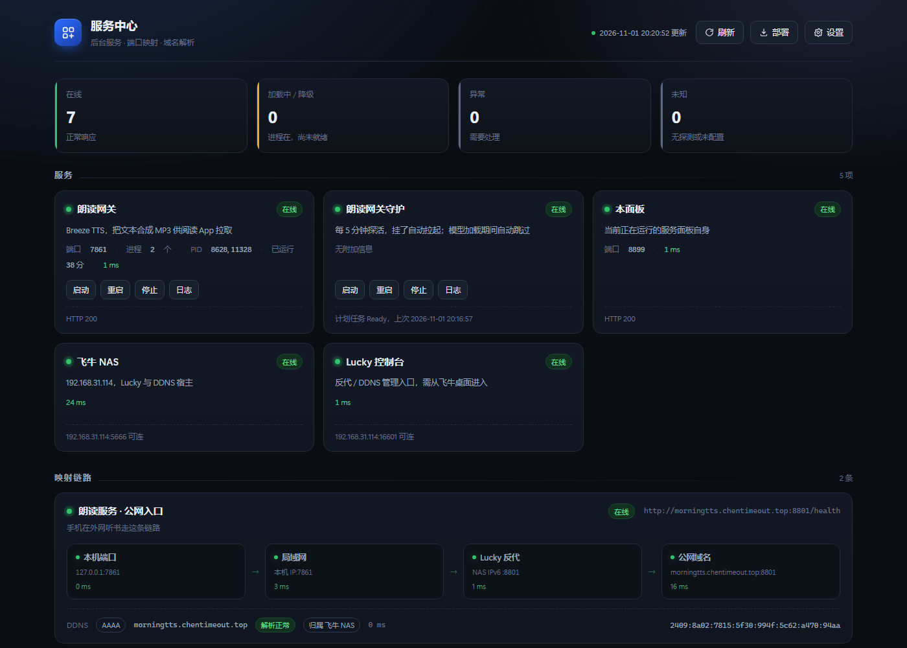
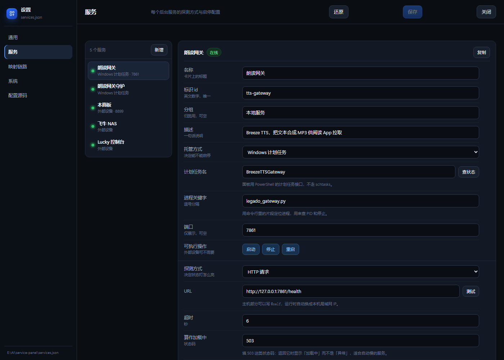
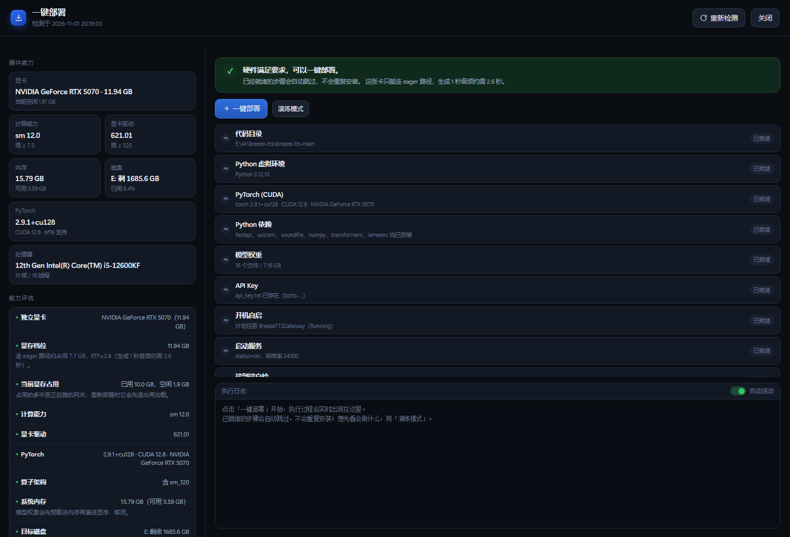

# 服务中心 · Service Panel

> Windows 上的本地服务面板：把「后台服务 + 端口映射 + 域名解析」收在一屏里看和管。
> 只监听 `127.0.0.1`，外网访问不到，不需要登录。

一个人在小机器上跑一堆东西时，最烦的不是启动，是**它们挂了以后你从哪儿知道**。
进程管理器只告诉你有没有 PID，不告诉你 `/health` 是不是 200；
反代和 DDNS 出了问题时，你也没法一眼看出断在本机、局域网还是域名那一段。

这个面板就是补这块的：一张卡片对应一个服务，一条链路拆成几段分别探活。



---

## 特性

| 能力 | 说明 |
|---|---|
| **服务卡片** | 状态灯、端口、PID、已运行时长、响应耗时、最近一次错误 |
| **启停控制** | 启动 / 重启 / 停止，走 PowerShell 计划任务 API；裸进程按命令行关键字找 PID |
| **实时日志** | 卡片上的「日志」直接 tail 最近的输出，自动滚到底 |
| **映射链路** | 一条链路拆成 N 段分别探活，任一段异常就整条变红，立刻知道断在哪 |
| **DDNS 检查** | 解析 AAAA/A，并判断解析出的地址与本机公网前缀是否同段——同段说明记录是新鲜的，不同段说明 DDNS 可能没更新 |
| **图形化设置** | 服务、链路、探测方式全部在网页里配，保存即热重载；每项探测旁边有「测试」按钮，拿表单里当前的值真发一次请求 |
| **一键部署** | 先检测硬件能力并给出三级结论，再按 9 个幂等步骤把服务从头装起来（见下文） |
| **零构建** | 后端 FastAPI，前端单文件 HTML，没有 npm、没有打包、没有 CDN |

自动刷新 5 秒一次。地址栏 `?tab=services` / `?view=deploy` 可以直接打开某一页。

---

## 快速开始

需要 Windows 10/11 + Python 3.10+。

```powershell
git clone <this-repo> service-panel
cd service-panel
powershell -ExecutionPolicy Bypass -File .\setup.ps1
```

`setup.ps1` 会建 `.venv`、装依赖、从 `services.example.json` 生成 `services.json`、
注册计划任务 `ServicePanel`（登录自启、无窗口、崩溃 1 分钟重试 5 次），然后打开浏览器。
重复执行是安全的，已完成的步骤会跳过。

不想装机自启：

```powershell
powershell -ExecutionPolicy Bypass -File .\setup.ps1 -NoTask
.\run_panel.cmd          # 前台跑，能看见所有输出，排错用
```

或者双击 `start-hidden.vbs`（无窗口启动；面板已在跑时会直接打开浏览器，不会起第二个）。

装完之后第一件事是打开「设置 → 服务」，把示例服务改成你自己的。
内置的示例只是演示三种托管方式和四种探测怎么写。

### 依赖

只有三个：`fastapi`、`uvicorn`、`psutil`。其余全是标准库——
探测用 `socket` / `urllib` / `subprocess`，DNSSEC 之类的花活一律没有。

---

## 界面

### 服务



三种托管方式：

- **`task`** — Windows 计划任务（推荐：能常驻、能开机自启、崩溃可重试）
- **`process`** — 直接拉起命令行，停止靠命令行关键字匹配
- **`external`** — 别的机器上的服务，只能看不能控

四种探测：`http`（最常用，可把 503 判成"加载中"而不是故障）、`tcp`、`dns`、`task`（只查计划任务状态）。

两个便利占位符，换网络不用改配置：

- `host: "@self"`，或 URL 里写 `@self` — 自动替换成本机主局域网 IPv4
- `resolve: "域名"` — 先把域名解析成 IPv6 再探端口

> `resolve` 不是花活。只监听 IPv6 的反向代理，用 IPv4 去连 `:8801` 永远返回「拒绝连接」，
> 看起来像服务挂了，其实是你探错了协议栈。

### 映射链路

一条链路 = 若干段，每段自己配探测，可以上移下移。

```
本机端口 → 局域网(@self) → 反代(resolve 域名) → 公网域名
   tcp          http             tcp               http
```

整条链路的状态取最差的那一段。出问题时不用挨个 SSH 上去试，界面直接告诉你断在第几段。

---

## 一键部署（硬件检测 → 从头装起来）

点右上角「**部署**」。

这个功能是给一类具体场景做的：**GPU 服务**。新机器上从零跑起一个 torch 项目要踩一堆坑——
建 venv、装错 CUDA 版本、被别的包覆盖成 CPU 版 torch、权重没下全、计划任务没注册。
所以把流程固化成幂等步骤，点一次跑完。



### 先判硬件，再决定能不能装

| 检测项 | 怎么来的 | 门槛（`deploy.requirements` 可改） |
|---|---|---|
| 显卡 / 显存 / 驱动 / 计算能力 | `nvidia-smi` | 显存 ≥ 8 GB，推荐 12，fast path 需 24；sm ≥ 7.5；驱动 ≥ 525 |
| PyTorch | 跑一次 venv 里的 torch | 必须 CUDA 可用 |
| 算子架构 | `torch.cuda.get_arch_list()` | 必须含本卡的 `sm_XX` |
| 内存 | psutil | ≥ 14 GB（权重要先预载进内存） |
| 磁盘 | 目标盘剩余 | ≥ 25 GB |

结论三级：**可以部署**（绿）／**能装但要留意**（黄，说明受限在哪、该怎么调）／**跑不了**（红）。
判红时「一键部署」按钮直接变灰并写明阻塞项，后端也二次拦截（HTTP 400 + 阻塞列表），不只靠前端。
硬件不达标时**演练模式仍然可用**。

### 九个步骤，每步先自检

代码目录 → venv → torch CUDA → Python 依赖 → 模型权重 → API Key → 计划任务 → 启动并轮询 `/health` → 端到端自检。

**幂等**是重点：每步先检查，已就绪就跳过。所以在装好的机器上点「一键部署」，
前 8 步秒过，只跑最后一次自检——真的合成一段音频、校验 MP3 帧头，而不是"进程还在"就算成功。
中途失败停在那一步，修好后重跑会从断点继续。

模型权重那一步故意**不做自动下载**：7 GB 在 HTTP 请求里同步拉，断一次就得从头来。
它只检查完整性，缺了给出下载命令让人自己跑。

> 这 9 步是按 [Breeze TTS](https://github.com/breezeblue-ai/breeze-tts) 的形状写的。
> 想复用到自己项目，改 `deploy.py` 里的 `build_steps()` 就行——每个 `Step` 就是一对
> `check()` / `run()`，检查返回 True 就跳过。

---

## 配置

全部在 `services.json`（首次运行从 `services.example.json` 复制）。
**日常用设置界面就够了**，下面是给批量改或想搞清字段含义时看的。

加一个受管服务：

```json
{
  "id": "my-app",
  "name": "我的应用",
  "group": "本地服务",
  "desc": "一句话说明",
  "kind": "task",
  "task": "我的计划任务名",
  "match": ["my_app.py"],
  "port": 8000,
  "probe": { "type": "http", "url": "http://127.0.0.1:8000/health", "timeout": 5, "expect": [200] },
  "logs": ["C:\\path\\app.log"],
  "actions": ["start", "stop", "restart"]
}
```

加一条映射链路：

```json
{
  "id": "my-chain",
  "name": "链路名",
  "desc": "说明",
  "access": "https://外网地址",
  "segments": [
    { "label": "本机", "hint": "127.0.0.1:8000", "probe": { "type": "tcp", "host": "127.0.0.1", "port": 8000 } },
    { "label": "公网", "hint": "外网域名", "probe": { "type": "http", "url": "https://外网域名/health", "timeout": 10 } }
  ],
  "ddns": { "record": "sub.example.com", "type": "AAAA", "owner": "归属设备" }
}
```

字段细节见 [README 完整说明](docs/config.md)（也可以直接在面板「设置 → 配置源码」里对着改）。

---

## 踩过的坑（改代码前先看）

**1. 别用 `schtasks.exe`。** 加固过的 Windows 上它可能被策略拦掉
（`PROGRAM BLOCKED BY SECURITY POLICY`），而且中文系统下输出是 GBK，解析必翻车。
本项目所有任务操作都走 `_task_bridge.ps1`（PowerShell 的 `Get-ScheduledTask` 一族），
一次批量查询、UTF-8 输出、不需要 `schtasks`。

**2. 别用 `Start-Process` 跑面板。** 这样起的进程活不长，会被回收。
必须挂在计划任务上——顺带白得了开机自启。

**3. `pythonw.exe` 可能起不来**（任务结果码 1）。用 `python.exe`，计划任务本身不显示窗口。

**4. `probe.type` 是探测类型，别再拿它当记录类型。** DNS 探测的记录类型字段叫 `record_type`，
否则 `{"type":"dns"}` 会被当成解析类型去查，直接失败。

**5. 改完配置立刻查状态，可能还是旧的。** 后台探测线程一轮要 1~4 秒。
保存时如果正好有一轮在跑，会排队等它结束后补一轮（约 2~4 秒生效）。
第一版没做排队，新配置要干等 5 秒才反映，像是没保存成功。

**6. 硬件检测慢在 `import torch`。** 首次 20 秒左右，之后走 `hw_cache.json`（10 分钟）。
依赖检查也踩过：原来真去 `import`，光 `transformers` 就 8 秒；改成
`importlib.util.find_spec` 只查包在不在，整页从 10.5 秒降到 3 秒。

**7. 显存判定要留容差。** 标称 12 GB 的卡报 12227 MiB = 11.94 GiB，
阈值写死 12.0 会把一台完全健康的机器判成「刚过最低线」。所有档位比较留 0.5 GB 余量。

**8. 接口别把非法 JSON 当空对象。** 一开始 `except: body = {}`，结果随便发个坏请求
就真启动了一次部署。现在解析失败直接 400。

**9. COM 的 `WScript.Shell` 建快捷方式可能被拦。** 桌面图标改用 `.url` 文本文件。

---

## 目录结构

```
service-panel/
  panel.py                 主程序：FastAPI + 后台探测线程 + 设置 / 系统 API
  deploy.py                硬件检测 + 能力评估 + 幂等部署执行器
  static/index.html        界面（单文件，无构建）
  services.example.json    配置模板（复制成 services.json 用）
  _task_bridge.ps1         计划任务桥：读状态 / 启停，替代 schtasks.exe
  _panel_restart.ps1       面板自重启（DETACHED 拉起，不会被自己杀掉）
  register_panel_task.ps1  注册 / 更新 ServicePanel 计划任务
  setup.ps1                一键安装（venv + 依赖 + 计划任务）
  run_panel.cmd            前台启动，排错用
  start-hidden.vbs         无窗口启动
  debug_dump.py            命令行拉一次状态打印成文本报告，排错用
  docs/                    截图与配置说明
```

运行时产物（`services.json`、`panel.log`、`hw_cache.json`）都在 `.gitignore` 里——
里面有你的内网 IP、域名和路径，不该进版本库。

---

## 限制

- **只支持 Windows。** 探测逻辑本身跨平台，但服务托管、启停、自启全建在任务计划程序上。
- **单用户、单机。** 没有多租户、没有审计日志。它就设计成一个人在自己机器上用的东西。
- **只监听 `127.0.0.1`。** 想从别的机器打开，请套一层反向代理并自己加认证；
  这个面板能启停进程，直接暴露到内网并不合适。

## License

MIT
